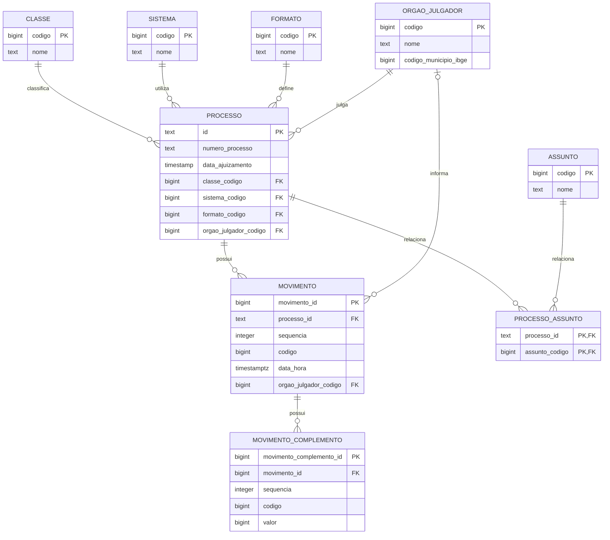

# Diagrama Entidade-Relacionamento

O diagrama apresenta as tabelas, as chaves principais e os relacionamentos usados para transformar o JSON do DataJud em um modelo relacional.

O relacionamento entre processo e assunto é muitos-para-muitos e foi resolvido pela tabela associativa `processo_assunto`. O órgão julgador do movimento é opcional porque esse objeto não aparece em todos os resultados da API.

